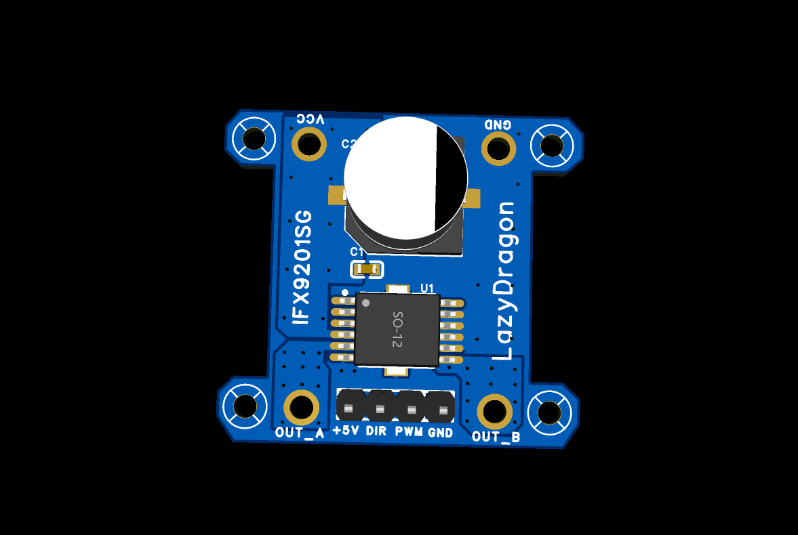

# LazyDragon IFX9201SG — 6 A Motor Driver Breakout



The **LazyDragon IFX9201SG motor driver** is a compact breakout for the
Infineon **IFX9201SG**, a 6 A H-bridge designed to drive a DC motor from a
`PWM` + `DIR` interface. It exposes a motor supply input, a pair of motor
outputs, and a 4-wire logic header — enough to spin a brushed DC motor from any
microcontroller.


This page covers the hardware at a glance. For the control details see
[`MANUAL.md`](MANUAL.md); for troubleshooting see [`DEBUG.md`](DEBUG.md).

---

## Overview

The IFX9201SG integrates four n-channel MOSFETs in an H-bridge plus gate drive,
charge pump, current limitation, and a full protection suite. Direction is set
by the `DIR` pin and speed by the duty cycle on `PWM`, so a controller needs only
two signal pins. The breakout adds the motor-side connectors, a `100 nF`
decoupling capacitor, and a `220 µF` bulk capacitor to absorb motor current
transients. The board is laid out on a small footprint with four mounting holes
for bolting to a chassis.

The board uses the **PWM/DIR** interface; the IC's SPI pins are not brought out.

---

## Highlights

- **6 A single-chip H-bridge.** One IFX9201SG drives a brushed DC motor with
  integrated gate drive and charge pump.
- **Two-pin control.** `PWM` sets speed, `DIR` sets direction — no external
  bridge or gate driver.
- **Wide motor supply.** `VS` operates up to 36 V, covering common robot
  batteries.
- **Robust protection.** Chopper current limitation, short-circuit and
  overtemperature shutdown, undervoltage lockout, and open-load detection.
- **Motor-side filtering.** Onboard `100 nF` + `220 µF` keep switching noise out
  of the supply.
- **Chassis-ready.** Four mounting holes on a 26.8 mm x 23.9 mm pattern.

---

## Specifications

| Spec | Value |
|------|-------|
| Driver IC | IFX9201SG — 6 A H-bridge with SPI |
| Package | PG-DSO-12-17 (SO-12 with exposed pad) |
| Switch on-resistance | 100 mΩ typ. per switch at Tj = 25 °C |
| Motor supply (`VS` / `VCC`) | up to 36 V |
| Logic supply (`VSO`) | 2.9 V .. 5.5 V (board ties `VSO` to +5 V) |
| Continuous output current | 6 A |
| Current limitation | 8 A typ. (chopper) |
| PWM frequency | up to 20 kHz |
| Control interface | `PWM` + `DIR` (this breakout) |
| Logic input levels | 3.3 V / 5.0 V TTL/CMOS compatible |
| Protections | overcurrent, short-circuit, overtemperature, undervoltage, open-load |
| Board size | 32.3 mm x 29.7 mm |
| Mounting holes | 4, on a 26.8 mm x 23.9 mm pattern |
| Decoupling | 100 nF + 220 µF |
| Interface | 4-pin logic header `H1` + `VCC`/`GND`/`OUT_A`/`OUT_B` pads |

> **Note:** per the IFX9201SG datasheet the part is **not** qualified for
> automotive/transportation use; for automotive designs use the TLE9201SG.

Mechanical drawings, assembly images, the schematic, the BOM, and the
manufacturing package are in `assets/`, `datasheets/`, and `fabrication/`.

---

## Repository structure

```
IFX9201SG_MotorDriver/
├── README.md
├── MANUAL.md
├── DEBUG.md
├── CHANGELOG.md
├── LICENSE            # hardware — CC BY-NC-SA 4.0
├── LICENSE-CODE       # firmware — PolyForm Noncommercial 1.0.0
├── COMMERCIAL-LICENSE.md
├── assets/            # images, schematic, BOM
├── datasheets/        # vendor datasheet
├── fabrication/       # gerbers, drill, pick-and-place
└── code/              # firmware / source
```

---

## Getting started

### Hardware

1. Connect the **motor supply** to `VCC` and the supply ground to `GND`.
2. Connect the motor across `OUT_A` and `OUT_B`.
3. Wire the logic header `H1` to your MCU: `+5 V`, `DIR`, `PWM`, `GND`.
4. Do not exceed the motor supply rating of the IFX9201SG (`VS` ≤ 36 V).

### Software

1. Open `code/ifx9201sg_motor_driver.ino` in the Arduino IDE (Arduino Nano /
   ATmega328P) and flash it — it runs a simple forward/reverse/stop demo.
2. To use it in your own sketch, copy the **CONFIG** + **DRIVER FUNCTIONS**
   sections and call `motorBegin()` in `setup()`, then `motorForward()`,
   `motorReverse()`, `motorDrive()`, `motorCoast()`, or `motorBrake()`.

---

## Usage / configuration

Direction and speed are set directly by the `DIR` and `PWM` inputs:

| `DIR` | `PWM` | Result |
|-------|-------|--------|
| 1 | 1 | Forward |
| 1 | 0 | Freewheeling (high-side 2) |
| 0 | 1 | Reverse |
| 0 | 0 | Freewheeling (high-side 1) |

`PWM` is a duty-cycle input; keep the PWM frequency at or below **20 kHz**.
In firmware this is abstracted by the `motor*()` calls in
[`MANUAL.md`](MANUAL.md) (`PIN_DIR`/`PIN_PWM` are configurable at the top of the
sketch).

---

## Pinout / wiring

**`H1` — 4-pin 2.54 mm logic header**

| Pin | Function |
|-----|----------|
| 1 | GND |
| 2 | PWM |
| 3 | DIR |
| 4 | +5 V |

**Power / motor pads**

| Pad | Function |
|-----|----------|
| `VCC` | Motor supply (`VS`) |
| `GND` | Supply / logic ground |
| `OUT_A` | Motor output 1 (`OUT1`) |
| `OUT_B` | Motor output 2 (`OUT2`) |

**IC tie-offs (fixed on the board):** `VSO` → `+5 V`; `VS` → `VCC`; `SO` not
connected; `SI`, `CSN`, `SCK`, `DIS` → `GND`; exposed pad → `GND`.

---

## Documentation

- [`MANUAL.md`](MANUAL.md) — usage and code/function reference.
- [`DEBUG.md`](DEBUG.md) — expected behavior and troubleshooting.
- [`CHANGELOG.md`](CHANGELOG.md) — version history.
- [`COMMERCIAL-LICENSE.md`](COMMERCIAL-LICENSE.md) — commercial licensing and royalties.
- Schematic and BOM: [`assets/`](assets/)
- Manufacturing files (gerbers, drill): [`fabrication/`](fabrication/)

---

## License

This project is **source-available, not open source**.

- **Hardware** (PCB, schematic, assets) — [`LICENSE`](LICENSE) ·
  [CC BY-NC-SA 4.0](https://creativecommons.org/licenses/by-nc-sa/4.0/): free
  for personal and non-commercial use with attribution; commercial use requires
  a separate license.
- **Firmware** (`code/`) — [`LICENSE-CODE`](LICENSE-CODE) ·
  [PolyForm Noncommercial 1.0.0](https://polyformproject.org/licenses/noncommercial/1.0.0):
  free for non-commercial use.

**Commercial use requires a paid license** (royalty + attribution). See
[`COMMERCIAL-LICENSE.md`](COMMERCIAL-LICENSE.md) or contact
**contact@lazydragon.club**.

### No warranty

The design and firmware are provided **"as is", without warranty of any kind**.
LazyDragon Pvt Ltd is **not liable** for any damages arising from their use. You
use this project at your own risk; verify all safety and certification
requirements before any product use.

> These licenses are non-commercial, so this is **not** an OSI open-source or
> OSHWA-certified open-hardware release.

**Background.** LazyDragon is a startup building open hardware. This board is
one of its earlier builds — designed from scratch in high school — now released
to the community alongside newer designs. These earlier releases are published
under source-available, non-commercial licenses.
